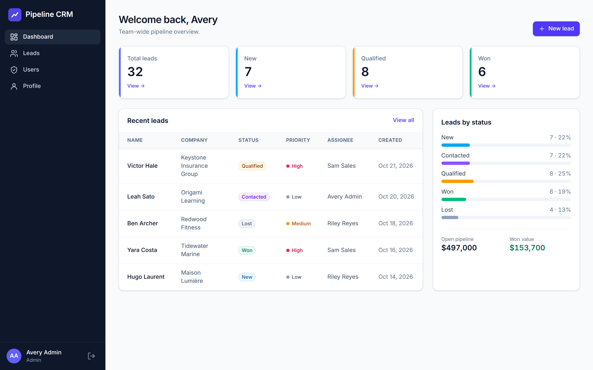
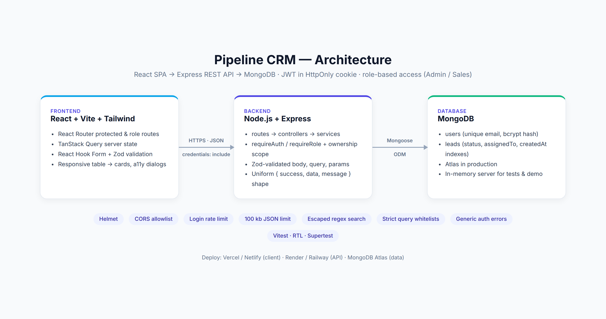
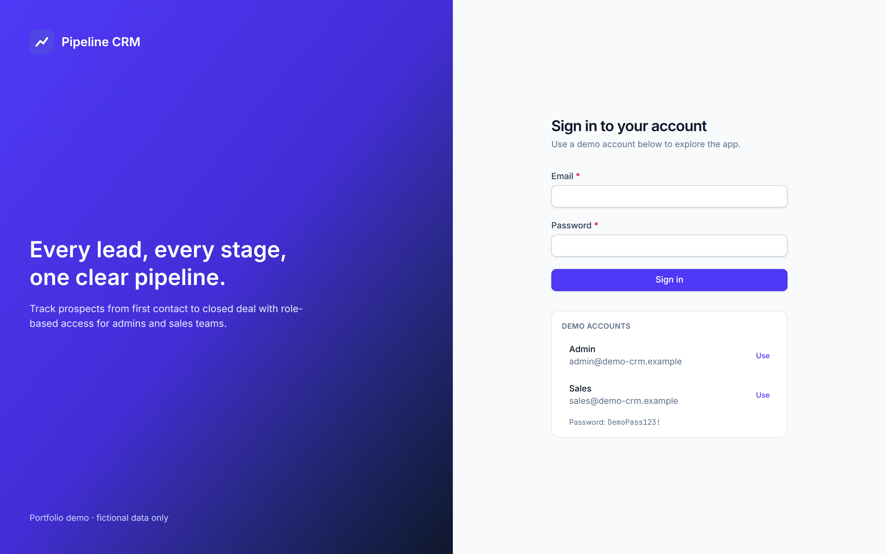
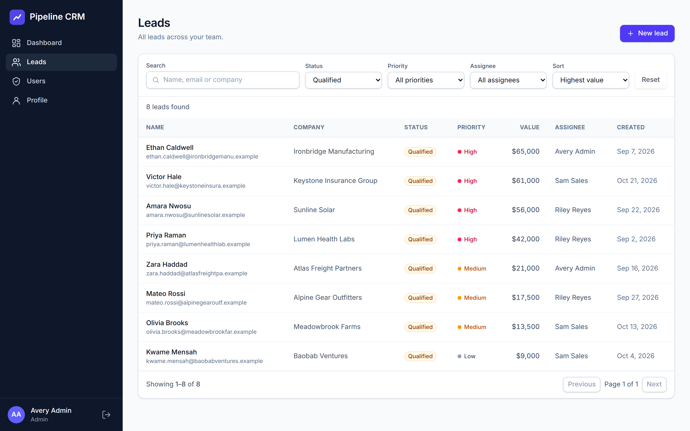
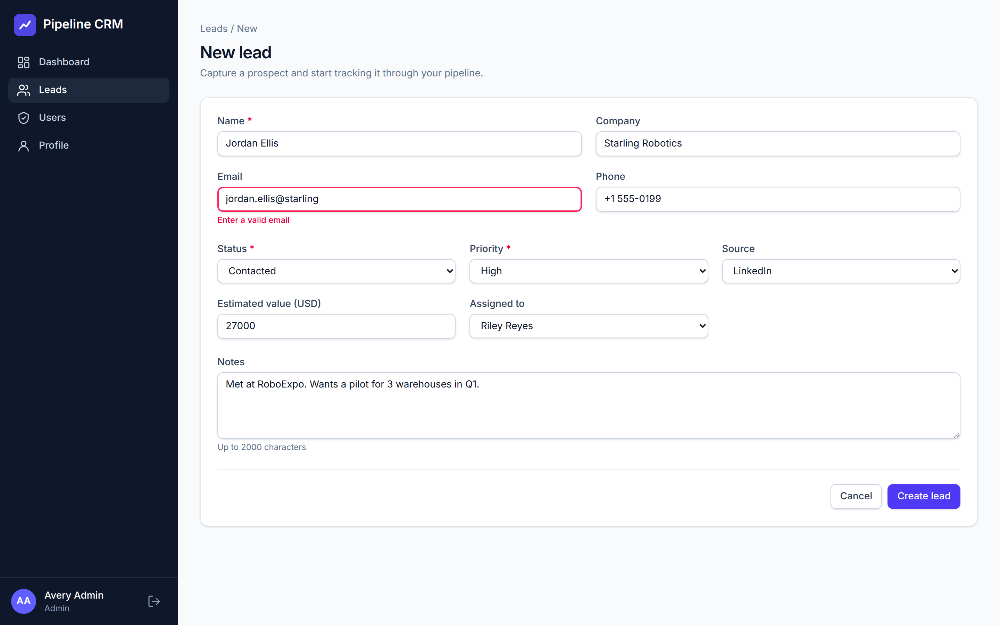
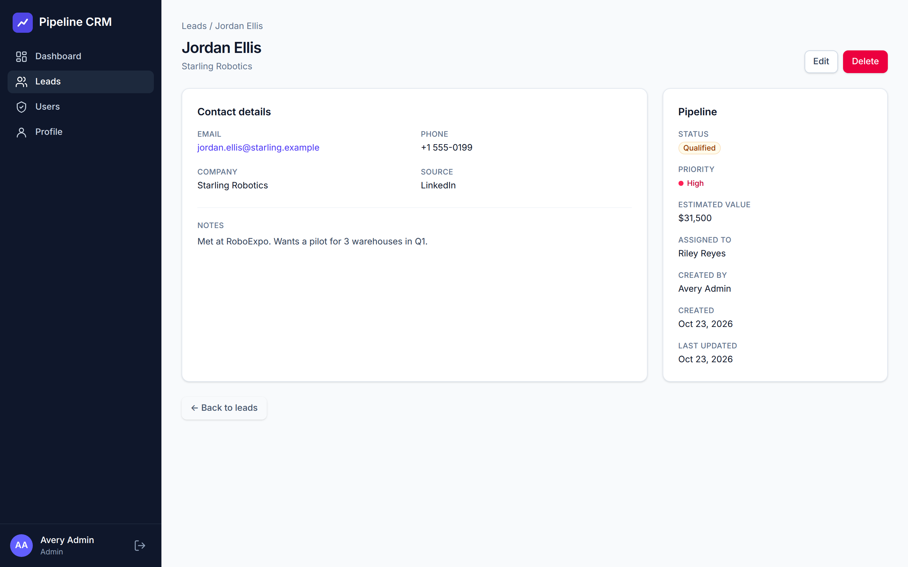
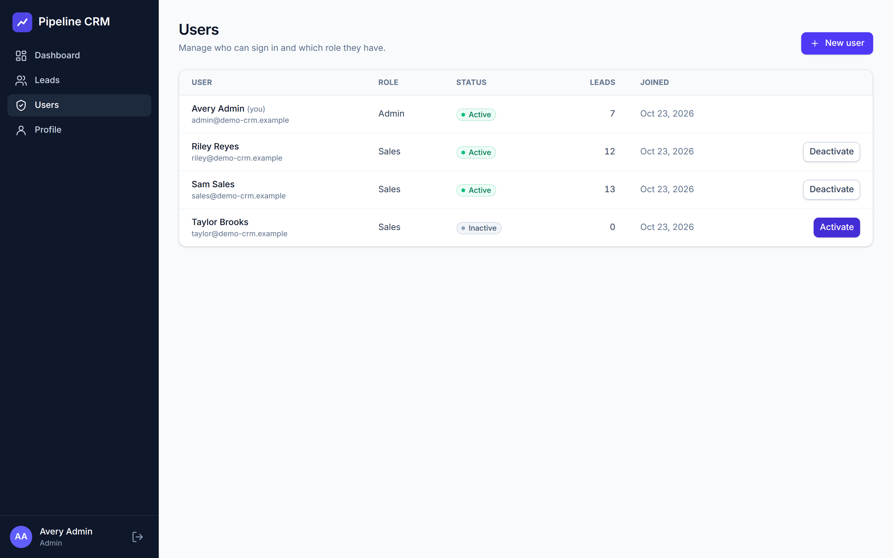
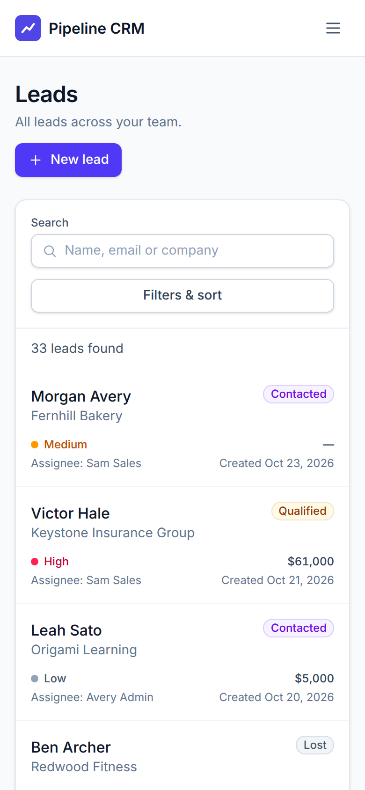

# CRM Dashboard | React, Node.js & MongoDB

A full-stack CRM dashboard for managing leads, assignments, statuses, and sales workflows. It includes a responsive React interface, an Express REST API, MongoDB models, JWT authentication in an HttpOnly cookie, and role-based authorization for Admin and Sales users.

> Independent portfolio project using fictional demo data only. No employer or client-confidential material is included.



## Problem and solution

Small sales teams often track leads in spreadsheets, where it's hard to see who owns which prospect and easy to edit someone else's rows by mistake. Pipeline CRM gives each salesperson a focused view of their own pipeline and gives admins the full picture, plus user management. Access rules are enforced by the API, not just hidden in the UI.

**Primary flow:** Login → Dashboard → Create lead → Update → Search/Filter → Delete (Admin).

## Features

- Cookie-based JWT sign-in and sign-out, session restored on refresh, generic login errors, rate-limited login
- Dashboard with Total / New / Qualified / Won KPIs, status distribution, open pipeline and won value, recent leads
- Leads list with debounced search (name, email, company), status, priority, and assignee filters, sorting, and server-side pagination. Filters are synced to the URL.
- Desktop table and mobile card layouts (usable at 320 px), with collapsible filters on mobile
- Create, view, edit, and delete leads, with Zod validation on both client and server and server field errors mapped onto the form
- Admin user management: list users with lead counts, create users, activate or deactivate them
- Loading skeletons, empty states, retryable error states, and success toasts
- Accessibility: visible labels, linked error messages, keyboard focus rings, focus-trapped confirm dialog, text status badges, a skip link

### Role permissions

| Action | Admin | Sales |
| ------ | :---: | :---: |
| View leads | All | Assigned to self |
| Create lead | Assign to any active user | Always assigned to self |
| Edit lead | Any | Own only |
| Reassign lead | ✓ | ✗ (403) |
| Delete lead | ✓ | ✗ (403) |
| Dashboard numbers | Team-wide | Own leads |
| Manage users (`/users`) | ✓ | ✗ (redirect in UI, 403 from API) |

Requests by Sales users for leads they don't own return **404**, so they can't tell whether a given ID exists.

## Architecture



| Layer | Choice | Why |
| ----- | ------ | --- |
| Frontend | React 19 + Vite + Tailwind CSS 4 | Fast builds, small bundle, utility styling without a UI kit |
| Data / forms | TanStack Query, React Hook Form + Zod | Cached server state with retry; one schema per form |
| Backend | Node.js + Express 4 | Clear routes → controllers → services layering |
| Database | MongoDB + Mongoose 8 | Indexed `status`, `assignedTo`, `createdAt`; unique `email` |
| Auth | JWT in an HttpOnly cookie, bcrypt | The token is never readable by JavaScript, which limits XSS token theft |
| Security | Helmet, CORS allowlist, login rate limit, 100 kb body limit, strict Zod schemas, escaped regex search | Production-minded defaults |
| Tests | Vitest, React Testing Library, Supertest, mongodb-memory-server, Playwright smoke | High-value coverage without external services |

```
client/src/   api/ components/ features/{auth,leads,dashboard,users}/ layouts/ pages/ routes/ utils/
server/src/   config/ controllers/ middleware/ models/ routes/ services/ utils/ validators/
server/tests/ Supertest suites      e2e/  browser smoke + screenshot script
docs/         PROJECT, DATA_MODEL, API, UI, CODING_RULES, QA, screenshots/
```

Contracts: [docs/API.md](docs/API.md) · [docs/DATA_MODEL.md](docs/DATA_MODEL.md) · [docs/UI.md](docs/UI.md) · [docs/PROJECT.md](docs/PROJECT.md) · [docs/QA.md](docs/QA.md)

## Local setup

Requires Node.js 20+ (tested on 22).

```bash
npm run install:all                 # installs server/ and client/
```

**Option A: no MongoDB install needed.** This starts an in-memory MongoDB, seeds the demo data, and runs the API:

```bash
npm run dev:server:memory           # API on http://localhost:5000 (data resets on restart)
npm run dev:client                  # UI on http://localhost:5173 (proxies /api to :5000)
```

**Option B: a real MongoDB (local or Atlas):**

```bash
cp server/.env.example server/.env  # then set MONGODB_URI and JWT_SECRET
npm run seed                        # 3 demo users + 32 fictional leads (wipes users/leads)
npm run dev:server
npm run dev:client
```

### Demo accounts

| Role | Email | Password |
| ---- | ----- | -------- |
| Admin | `admin@demo-crm.example` | `DemoPass123!` |
| Sales | `sales@demo-crm.example` | `DemoPass123!` |
| Sales | `riley@demo-crm.example` | `DemoPass123!` |

These are non-sensitive demo credentials. Rotate `DEMO_PASSWORD` and re-seed if a public demo gets abused.

## Environment variables

**Server** (`server/.env`, see `server/.env.example`):

| Name | Required | Example / default | Notes |
| ---- | :------: | ----------------- | ----- |
| `NODE_ENV` | | `development` | `production` enables `Secure` + `SameSite=None` cookies and `trust proxy` |
| `PORT` | | `5000` | Render/Railway inject this automatically |
| `MONGODB_URI` | ✓ | `mongodb+srv://…/crm-dashboard` | Atlas connection string |
| `JWT_SECRET` | ✓ | 48+ random bytes | At least 16 characters (validated at startup) |
| `JWT_EXPIRES_IN` | | `1d` | Also sets the cookie lifetime |
| `CLIENT_ORIGIN` | ✓ in prod | `https://crm-demo.vercel.app` | Comma-separated CORS allowlist |
| `LOGIN_RATE_LIMIT` | | `20` | Login attempts per IP per 15 minutes |
| `DEMO_PASSWORD` | seed only | `DemoPass123!` | Used by `npm run seed` |

**Client** (`client/.env`, see `client/.env.example`):

| Name | Notes |
| ---- | ----- |
| `VITE_API_URL` | Leave empty when `/api` is proxied (dev, or the Vercel/Netlify rewrite below). Set to the API origin only for direct cross-site calls. |

## Deployment

The app hasn't been deployed yet because that needs the owner's hosting accounts. These are the steps for the usual free-tier setup:

1. **MongoDB Atlas.** Create a cluster and a database user. Allow network access from your API host, then copy the connection string into `MONGODB_URI`.
2. **API on Render or Railway.**
   - Root directory: `server`
   - Build command: `npm install`
   - Start command: `npm start`
   - Health check path: `/api/health`
   - Environment: `NODE_ENV=production`, `MONGODB_URI`, `JWT_SECRET`, `CLIENT_ORIGIN=https://<your-client-domain>`
3. **Seed.** Run `npm run seed` once with the production env vars (from your machine, or a Render shell, with `DEMO_PASSWORD` set). It wipes users and leads.
4. **Client on Vercel or Netlify.**
   - Root directory: `client`
   - Build command: `npm run build`
   - Output directory: `dist`
   - Replace `YOUR-API-HOST` in `client/vercel.json` (Vercel) or `client/public/_redirects` (Netlify) with the API host.
5. **Cookies and CORS.** The recommended setup proxies `/api` through the client host using the rewrite files above. The auth cookie is then first-party, which avoids third-party-cookie blocking in Safari and Chrome, and `VITE_API_URL` stays empty. If you call the API cross-site instead, set `VITE_API_URL=https://<api-host>`. The server already sends `SameSite=None; Secure` cookies in production, and `CLIENT_ORIGIN` must exactly match the client origin.
6. **Verify on the public URLs.** Walk through the flows in [docs/QA.md](docs/QA.md), check for cold starts on free tiers, and add an uptime ping to `/api/health` if your host supports it.

## API overview

| Method | Route | Access |
| ------ | ----- | ------ |
| GET | `/api/health` | Public |
| POST | `/api/auth/login` · `/api/auth/logout` | Public |
| GET | `/api/auth/me` | Authenticated |
| GET / POST | `/api/leads` | Authenticated (role-scoped) |
| GET / PATCH | `/api/leads/:id` | Admin or assignee |
| DELETE | `/api/leads/:id` | Admin |
| GET | `/api/dashboard/stats` | Authenticated (role-scoped) |
| GET | `/api/users/assignable` | Authenticated |
| GET / POST | `/api/users` · PATCH `/api/users/:id/status` | Admin |

Example: `GET /api/leads?search=acme&status=qualified&assignedTo=<id>&page=1&limit=10&sort=-createdAt` returns `{ success, data: { items, page, limit, total, totalPages } }`. All responses use `{ success, data, message }`, and errors use `{ success: false, message, errors: [{ field, message }] }`. See [docs/API.md](docs/API.md) for the full contract.

## Tests

```bash
npm test                    # server (48) + client (19)
npm run lint                # ESLint for server + client
npm run build               # production client build

# Browser acceptance run + screenshots (needs the dev stack running and a Chrome binary)
cd e2e && npm install && CHROME_PATH=$(which google-chrome) npm run smoke
```

The server tests start their own in-memory MongoDB, so they don't need any external services.

## Screenshots

| | |
| --- | --- |
|  Login with demo access |  Leads with filters, sort, pagination |
|  Create form with validation |  Lead detail |
|  Admin user management |  Mobile leads layout |

## Known limitations

- Search uses an escaped, case-insensitive regex, which is fine for demo-sized data but can't use an index. Switch to a text index or Atlas Search at scale (see [docs/DATA_MODEL.md](docs/DATA_MODEL.md)).
- There is no password reset, email verification, or self-service profile editing. Admins create accounts with a temporary password.
- JWTs aren't revoked server-side on logout. The cookie is cleared, and deactivated users are rejected on their next request. Add a token denylist or short-lived tokens with refresh if that's needed.
- The rate limiter uses in-memory storage, so each instance counts separately. Use a Redis store when running more than one instance.
- No activity log or lead history, and no CSV import/export.

## My contribution

<!-- Edit before publishing: describe exactly what you built and decided yourself. -->
Built end to end: data model and API contract, Express API with authentication, role and ownership authorization and validation, MongoDB schemas, indexes and seed data, the React UI (routing, data layer, forms, responsive layouts, accessibility), automated tests, the browser smoke script, and this documentation. The project was built in small vertical slices with AI assistance, and every security and authorization rule was reviewed and tested.
